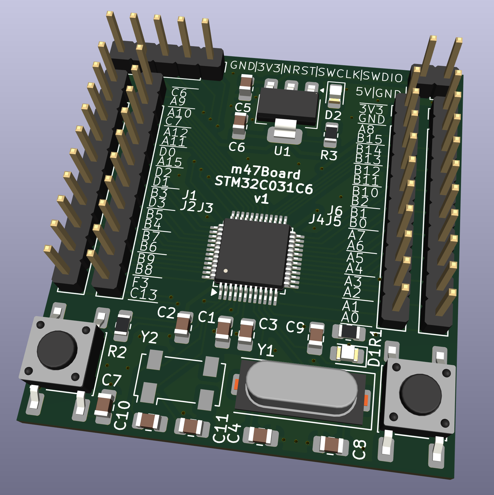
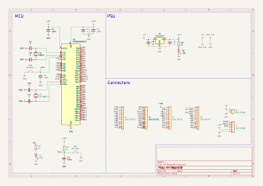

# m47Board

## Custom PCB designed for STM32 Dev Board
- STM32C031C6T6 MCU
- HSE and LSE external oscillators
- SWD programming interface
- Goldpin headers for all GPIO pins
- User button and user LED
- TLV1117LV33 5V to 3.3V 1A LDO
- RST button

## PCB render

## Schematic

